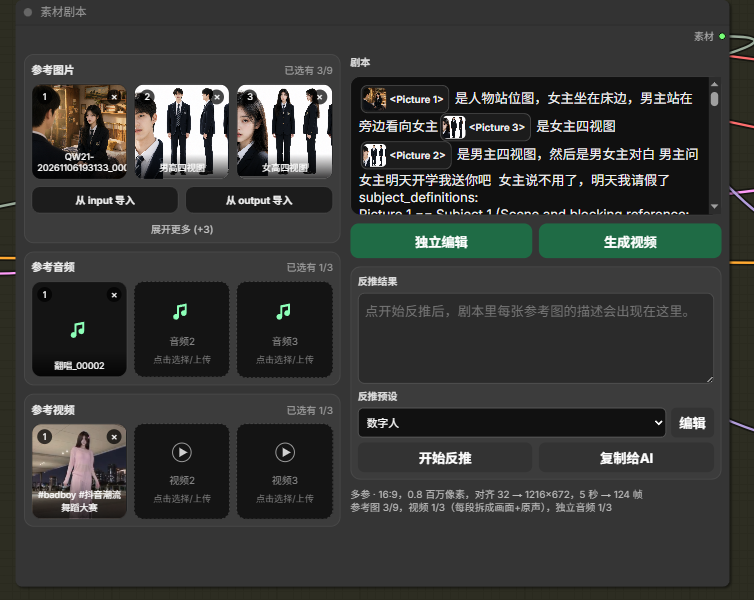

> **推荐关注我的 B 站主页**，更多 ComfyUI 工作流教程与插件更新都在这里：**B站：肥猫AIGC：https://space.bilibili.com/280681975**

# feimao-h3 导演台

MiniMax H3 的导演台。模型、画幅、素材、剧本和反推放在一套节点里，用来做多参、文生、图生和首尾帧。



## 安装

放到 ComfyUI 的 `custom_nodes` 里，然后完全退出并重新打开 ComfyUI。

```bash
cd ComfyUI/custom_nodes
git clone https://github.com/taofuli8/feimao-h3-director.git
```

需要已经能跑 MiniMax H3 的 ComfyUI，以及多参模型、文生模型、Qwen3-VL CLIP、视频 VAE 和音频 VAE。

## 工作流

示例工作流在 [`workflows/MiniMax-H3-多参导演台.json`](workflows/MiniMax-H3-多参导演台.json)。

画布从左到右分成六组：

1. 模型加载
2. LoRA 与加速
3. 导演设置
4. 素材剧本
5. 采样
6. 成片

工作流里带着一份示例素材和剧本。换自己的图、音频和视频之后再生成。

## 节点

| 节点 | 作用 |
| --- | --- |
| H3模型加载 | 按模式加载多参模型或文生模型，并给出 CLIP、视频 VAE、音频 VAE |
| H3导演设置 | 画幅、百万像素、秒数、模式、反推模型和视觉模型 |
| H3素材剧本 | 参考图、参考音频、参考视频、剧本、反推和生成 |
| H3模式分流 | 按是否走多参切换两路模型 |

素材可以从本机上传，也可以从 ComfyUI 的 input 和 output 导入。剧本里用 `<Picture N>`、`<Audio N>`、`<Video N>` 点名真正参与生成的素材。多参只把写进剧本的素材送进采样。

反推预设有数字人、MV 和漫剧。复制给 AI 时会带上对应的 H3 写法和剧本里的原句。

## 许可

[MIT](LICENSE)
